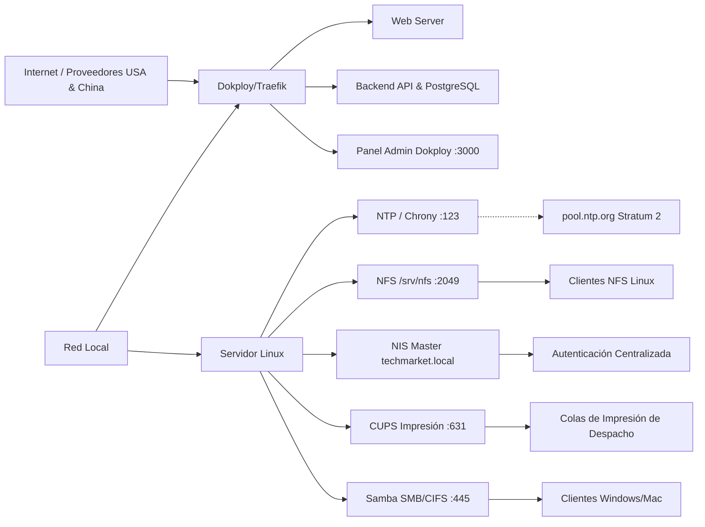

# Proyecto Final: Administración de Infraestructura de TI
## Documento de Análisis y Diseño (Semana 1)
**Institución:** Universidad del Quindío  
**Facultad:** Ingeniería de Sistemas y Computación  
**Programa:** Ingeniería de Sistemas y Computación  
**Asignatura:** Administración de Infraestructura de TI  
**Semestre:** 2026-1  
**Estudiante:** Andrés Felipe Cepeda Castrillón  
**Identificación:** C.C. 1139874140  
**Empresa Seleccionada:** TECHMARKET S.A.S.  

---

## 1. Perfil y Contexto de la Organización

**TECHMARKET S.A.S.** es una empresa comercializadora e importadora de tecnología con sede principal en Armenia (Quindío). Su modelo de negocio se basa en:
1. **Importación directa de productos de alta rotación:** Procedentes de China (Shenzhen, Guangzhou) y Estados Unidos (Miami, Los Ángeles), tales como componentes de computadores, laptops corporativas, smartphones, periféricos para gaming, accesorios de conectividad y dispositivos IoT.
2. **Reventa y distribución mayorista y minorista:** A través de canales digitales (portal web/e-commerce) y despacho directo a clientes corporativos y consumidores finales a nivel local y nacional.
3. **Operación logística y técnica:** Recepción en bodega aduanera/local, inspección de calidad técnica, serialización de equipos para garantías, facturación legal, impresión masiva de guías de despacho/etiquetas térmicas y control riguroso de inventarios en tiempo real.

### 1.1 Problemática y Desafíos de Infraestructura
Antes de la intervención, TECHMARKET operaba con servicios dispersos, equipos aislados y almacenamiento local no estructurado:
* Falta de un catálogo y portal web centralizado con alta disponibilidad para consultar inventario y precios en tiempo real.
* Dispersión de documentos contables, certificados de importación (DEX, declaraciones aduaneras DIAN) y facturas entre computadores de usuarios.
* Falta de sincronización horaria precisa, lo que provocaba inconsistencias en los registros de auditoría de aduanas y facturación electrónica.
* Gestión ineficiente de impresiones de guías de transporte y facturas en el área de bodega y despacho.
* Inexistencia de un esquema centralizado de autenticación para los administradores y técnicos de soporte en servidores Linux.
* Dificultades para que el personal administrativo (en estaciones Windows y macOS) comparta archivos de forma segura y estructurada según su rol.

---

## 2. Justificación de los Servicios Propuestos

Para solventar estos desafíos, se diseñó e implementó una infraestructura híbrida centralizada sobre **Ubuntu Server 24.04/26.04 LTS (aarch64)**, combinando la plataforma PaaS moderna **Dokploy** (para el despliegue ágil y seguro de servicios en contenedores) y **servicios nativos Linux empresariales** para la operación de red local.

### 2.1 Dokploy (Plataforma PaaS y Reverse Proxy Traefik)
* **Justificación:** TECHMARKET requiere agilidad en el despliegue y actualización de su portal corporativo y APIs sin incurrir en costos elevados de nubes públicas ni en la complejidad operativa de clústeres sobredimensionados. Dokploy proporciona una interfaz web centralizada con gestión de contenedores Docker, despliegue continuo vía repositorios Git (Nixpacks/Dockerfiles), monitoreo de métricas (CPU/RAM) y orquestación con Traefik como proxy inverso y terminador TLS/SSL automático (Let's Encrypt).

### 2.2 Servicio Web Institucional y Catálogo (HTTPS)
* **Justificación:** Es la vitrina digital de TECHMARKET. Permite a los clientes mayoristas y minoristas consultar la disponibilidad de productos importados, especificaciones técnicas, precios en pesos colombianos (COP) y contactar al área de ventas corporativas. Corre en un contenedor optimizado, asegurado mediante HTTPS estricto con certificados SSL/TLS, garantizando confidencialidad e integridad de la información comercial.

### 2.3 Base de Datos Relacional (PostgreSQL en Dokploy)
* **Justificación:** Se requiere almacenar de manera estructurada, transaccional y consistente el maestro de productos, categorías tecnológicas (laptops, accesorios, componentes, etc.), fabricantes, países de procedencia (USA/China), stock disponible y órdenes de compra. PostgreSQL garantiza integridad referencial, soporte ACID y excelente rendimiento para consultas concurrentes.

### 2.4 Servidor de Tiempo (NTP / Chrony)
* **Justificación:** En una empresa importadora, la sincronización de reloj es crítica:
  1. Coherencia en los sellos de tiempo (*timestamps*) de facturación electrónica y validaciones aduaneras.
  2. Alineación de logs de eventos y auditoría en servidores y estaciones de trabajo para trazabilidad y seguridad.
  3. Previene errores de expiración prematura de tokens de sesión y certificados SSL/TLS.
  Se configura un servidor NTP corporativo enlazado con la jerarquía `pool.ntp.org` (Stratum 2, nodos Colombia y Sudamérica) que actúa como fuente de tiempo autoritativa para toda la red de TECHMARKET.

### 2.5 Compartición de Archivos para Linux (NFS - Network File System)
* **Justificación:** Los servidores de backend, servidores de backups y estaciones técnicas de soporte (Ubuntu/Debian) necesitan acceder de forma transparente y con alto rendimiento a volúmenes compartidos. Se dispone de un recurso `/srv/nfs/techmarket` segmentado en directorios para `backups`, `catalogos` y `general`, montado nativamente en clientes Linux vía protocolo NFSv4.

### 2.6 Autenticación Centralizada de Usuarios (NIS - Network Information Service)
* **Justificación:** Para evitar la creación repetitiva de cuentas de usuario en cada estación y servidor Linux del equipo técnico y de infraestructura, se implementa NIS como servicio de directorio ligero. Centraliza las credenciales (`passwd`, `group`, `hosts`) bajo el dominio corporativo `techmarket.local`, permitiendo que un administrador o técnico inicie sesión en cualquier terminal cliente con sus mismas credenciales.

### 2.7 Servidor de Impresión en Red (CUPS - Common Unix Printing System)
* **Justificación:** El área de logística y despacho de TECHMARKET emite constantemente guías de envío (servientrega, coordinadora, interrapidísimo), manifiestos aduaneros y facturas. CUPS centraliza y gestiona las colas de impresión, administrando prioridades, control de acceso web (puerto 631) y compatibilidad multiplataforma (IPP/RAW/PDF) para impresoras térmicas y láser.

### 2.8 Compartición de Archivos Multiplataforma (Samba / SMB-CIFS)
* **Justificación:** Las estaciones de trabajo de los departamentos de Gerencia, Ventas, Contabilidad y Bodega utilizan mayoritariamente Windows 10/11 y macOS. Samba permite exponer recursos compartidos protegidos por contraseña (`smbpasswd`) y control de acceso basado en grupos de Linux (`@ventas`, `@compras`, `@bodega`, `@admin`), asegurando que, por ejemplo, el personal de bodega solo edite despachos y el de contabilidad/compras tenga acceso exclusivo a estados financieros y soportes aduaneros.

---

## 3. Tabla de Requisitos de Red y Servicios

A continuación se detalla la matriz técnica de direccionamiento, puertos y roles verificados en la infraestructura de TECHMARKET S.A.S.:

| Servicio | Nombre del Host / Contenedor | Dirección IP | Puerto(s) | Protocolo | Capa Transporte / App | Función Específica en TECHMARKET |
| :--- | :--- | :--- | :--- | :--- | :--- | :--- |
| **Gateway / Router** | `gw-techmarket` | `192.168.1.1` | - | - | Red | Salida a Internet y resolución DNS externa |
| **Servidor Principal** | `srv-infra.techmarket.local` | `192.168.1.109` | - | - | Sistema Base | Servidor Ubuntu Server 24.04/26.04 (2 vCPUs, 4GB RAM) |
| **Panel Dokploy** | `dokploy.techmarket.local` | `192.168.1.109` | 3000 | TCP | HTTP / Web | Panel de administración PaaS, monitoreo y CI/CD |
| **Proxy Traefik** | `srv-infra.techmarket.local` | `192.168.1.109` | 80, 443 | TCP | HTTP / HTTPS | Enrutamiento perimetral, SSL/TLS Let's Encrypt |
| **Web Institucional** | `app.techmarket.local` | `192.168.1.109` | 8080 (o 80/443 Traefik) | TCP | HTTP / HTTPS | Catálogo interactivo de productos importados y stock |
| **Base de Datos** | `techmarket_postgres` | `192.168.1.109` | 5432 | TCP | PostgreSQL 16 | Almacenamiento de catálogo, importaciones y pedidos |
| **Servidor NTP** | `srv-infra.techmarket.local` | `192.168.1.109` | 123 | UDP | NTP / Chrony | Sincronización horaria (Stratum 2 Sudamérica/Colombia) |
| **Servidor NFS** | `srv-infra.techmarket.local` | `192.168.1.109` | 2049, 111 | TCP/UDP | NFSv4 / RPC | Compartición de imágenes de catálogo y backups Linux |
| **Servidor NIS** | `srv-infra.techmarket.local` | `192.168.1.109` | 111, 834, 835 | TCP/UDP | Portmapper / YP | Autenticación centralizada (`techmarket.local`) |
| **Servidor CUPS** | `srv-infra.techmarket.local` | `192.168.1.109` | 631 | TCP | IPP / HTTP | Cola e impresión de guías y facturas de despacho |
| **Servidor Samba** | `srv-infra.techmarket.local` | `192.168.1.109` | 139, 445 | TCP | NetBIOS / SMB | Carpetas compartidas de ventas, compras y bodega |
| **SSH Remoto** | `srv-infra.techmarket.local` | `192.168.1.109` | 22 | TCP | SSH | Gestión remota segura por terminal |

---

## 4. Estructura de Usuarios y Permisos Empresariales

Para garantizar el principio de menor privilegio, se establecen los siguientes grupos y usuarios en el sistema:

| Grupo | Miembros | Carpeta Samba Asignada | Permisos | Propósito |
| :--- | :--- | :--- | :--- | :--- |
| `admin` | `admin_tech`, `andres_cepeda` | `/srv/samba/techmarket/general` y raíz | R/W completo | Administración integral de la infraestructura |
| `ventas` | `juan_ventas` | `/srv/samba/techmarket/ventas` | R/W en ventas, R en general | Listas de precios, pedidos de clientes locales |
| `compras` | `carlos_import` | `/srv/samba/techmarket/importaciones`| R/W en importaciones | Documentos aduaneros, packing lists de USA/China |
| `bodega` | `pedro_bodega` | `/srv/samba/techmarket/despachos` | R/W en despachos, impresión CUPS | Guías de despacho, seriales físicos de mercancía |

---

## 5. Diagrama de Arquitectura de Infraestructura

