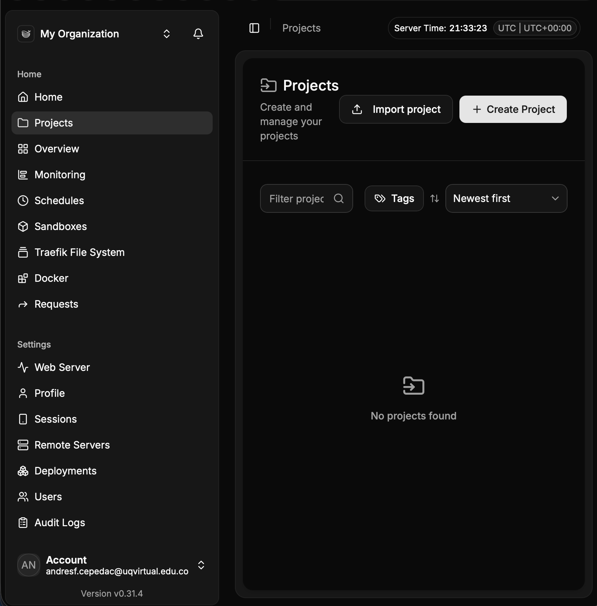
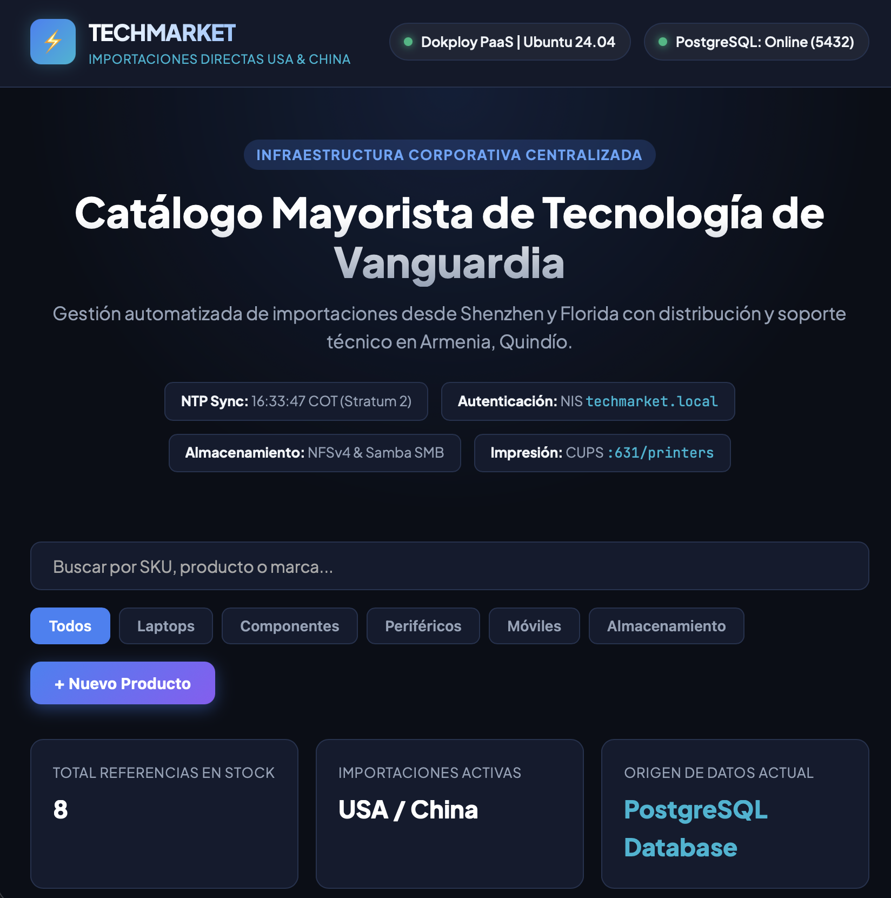
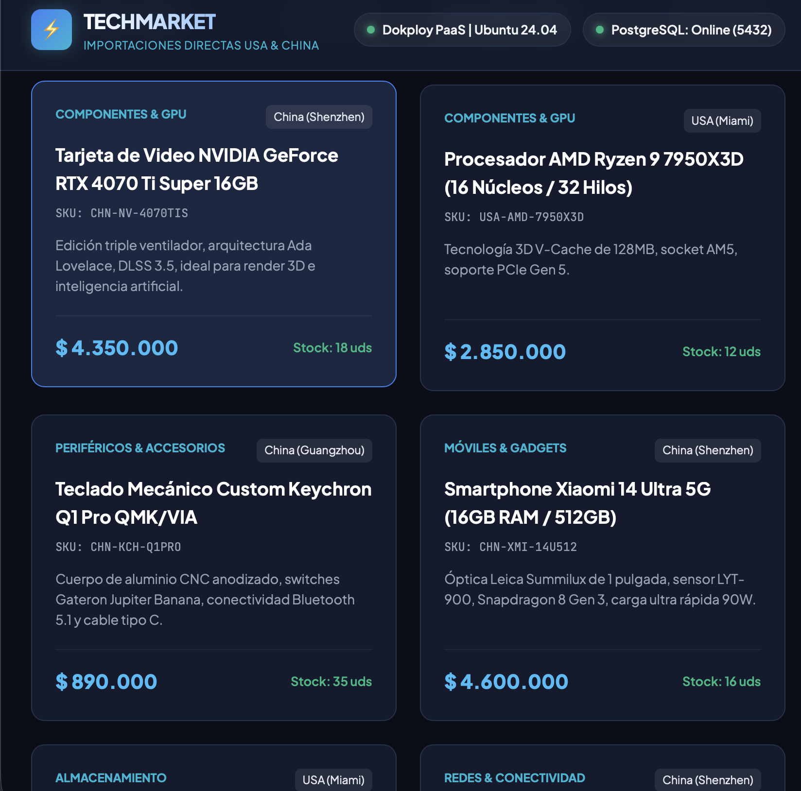
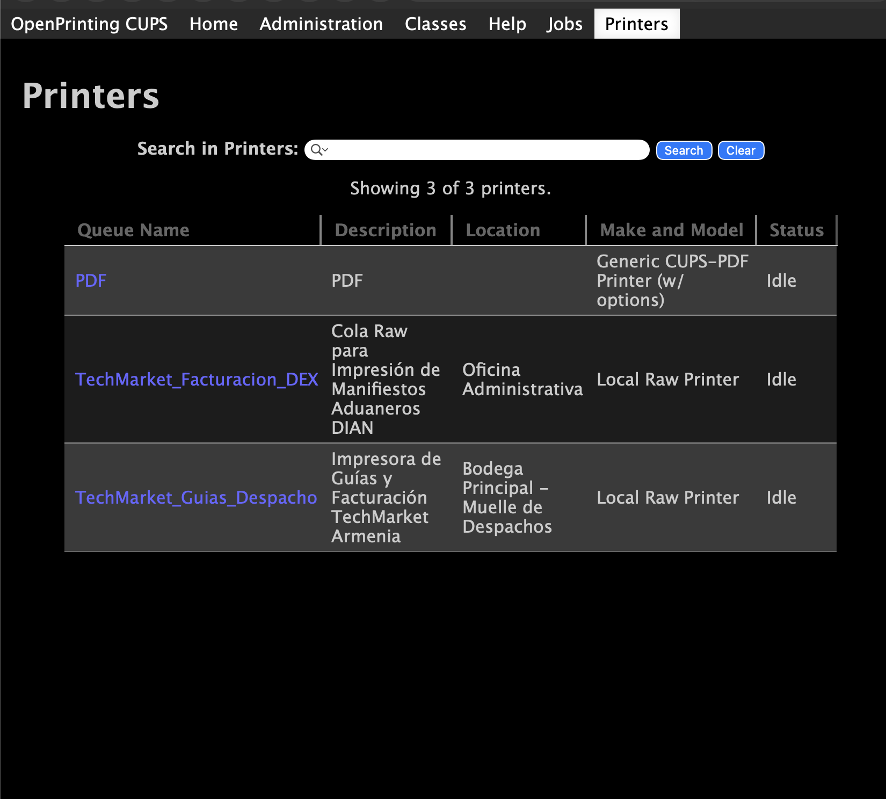
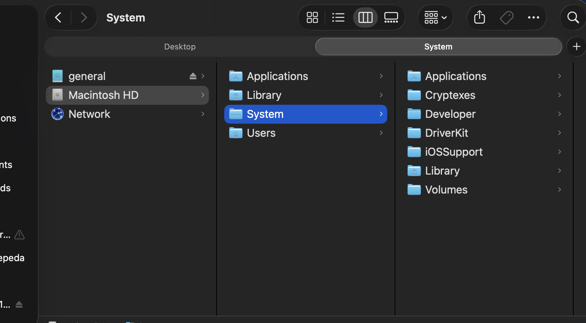
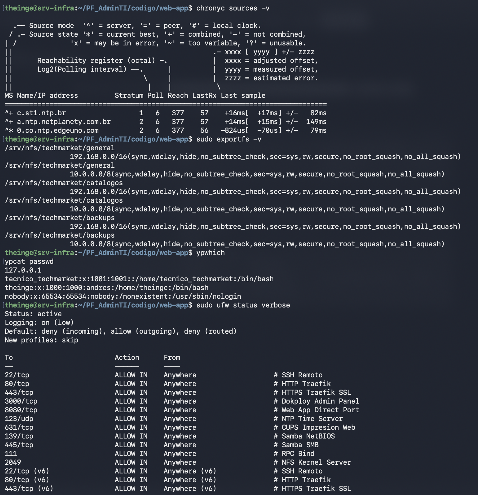

# TECHMARKET S.A.S. - Infraestructura de TI
## Documentación Técnica Completa, Guía de Operaciones y Evidencias (Semana 4)

**Asignatura:** Administración de Infraestructura de TI  
**Facultad:** Ingeniería de Sistemas y Computación  
**Institución:** Universidad del Quindío  
**Semestre:** 2026-1  
**Estudiante:** Andrés Felipe Cepeda Castrillón  
**Identificación:** C.C. 1139874140  
**Empresa:** TECHMARKET S.A.S. (Importación de Tecnología desde China y USA)  
**Entorno Operativo:** Ubuntu Server 24.04/26.04 LTS (`aarch64` en Apple M1)  
**IP Asignada en Red Puente (Bridged):** `192.168.1.109`  

---

## 1. Resumen Ejecutivo y Arquitectura del Sistema

**TECHMARKET S.A.S.** es una empresa especializada en la importación directa y distribución mayorista de dispositivos tecnológicos de vanguardia procedentes de Shenzhen (China) y Miami (USA). Para su centro de operaciones en Armenia (Quindío), se diseñó e implementó una infraestructura de TI híbrida y resiliente sobre **Ubuntu Server 24.04/26.04 LTS**, virtualizado sobre **UTM** en hardware Apple Silicon.

La plataforma resuelve dos necesidades operativas fundamentales:
1. **Capa Web y PaaS Moderna (Dokploy & Traefik):** Aislamiento en microservicios contenerizados (Docker) para el portal corporativo de ventas y la base de datos transaccional PostgreSQL 16, con gestión de tráfico web y proxy inverso.
2. **Capa de Servicios de Red Linux Tradicionales:** Servicios corporativos de baja latencia ejecutados en el sistema operativo host (NTP/Chrony, NFSv4, NIS Master, CUPS IPP y Samba CIFS), asegurados por un Firewall perimetral UFW y copias de seguridad programadas con Cron.

---

## 2. Topología de Red y Matriz de Servicios Verificados

| Servicio | Identificador | Dirección IP / Puerto | Protocolo | Estado Verificado | Rol en TECHMARKET |
| :--- | :--- | :--- | :--- | :--- | :--- |
| **Panel Dokploy** | `dokploy` | `http://192.168.1.109:3000` | TCP / HTTP | **100% Operativo** | Gestión PaaS de aplicaciones y métricas de servidor |
| **Portal Web** | `techmarket_web_app` | `http://192.168.1.109:8080` | TCP / HTTP | **100% Operativo** | Catálogo interactivo de laptops, GPUs y periféricos |
| **Base de Datos** | `techmarket_postgres` | `192.168.1.109:5432` | TCP / PGSQL | **Healthy** | Tabla `productos` con stock, SKUs y precios COP |
| **Servidor NTP** | `chrony` | `192.168.1.109:123` | UDP / NTP | **Sincronizado (Stratum 2)** | Sellos de tiempo para facturación y auditoría aduanera |
| **Servidor NFS** | `nfs-kernel-server` | `192.168.1.109:2049` | TCP / NFSv4 | **Exportando** | Carpetas `/srv/nfs/techmarket/{general,catalogos,backups}` |
| **Servidor NIS** | `ypserv / ypbind` | `192.168.1.109:111` | TCP/UDP RPC | **Master Activo** | Dominio `techmarket.local` con usuario `tecnico_techmarket` |
| **Servidor CUPS** | `cupsd` | `http://192.168.1.109:631` | TCP / IPP | **3 Impresoras Listas** | Colas `TechMarket_Guias_Despacho` y `Facturacion_DEX` |
| **Servidor Samba**| `smbd` | `\\192.168.1.109\general` | TCP / 445 SMB| **Autenticado** | Comparticiones por área: `ventas`, `importaciones`, `despachos` |
| **Firewall UFW** | `ufw` | Todas las interfaces | Kernel Netfilter | **Active (Default Deny)** | Protección estricta con apertura selectiva de puertos |
| **Backup Diario**| `cron / bash` | Local + NFS | Script Cron | **Automatizado (02:00 AM)** | Respaldo comprimido de configs y volcados SQL |

---

## 3. Evidencias de Funcionamiento por Servicio

### 3.1 Dokploy (Plataforma PaaS y Administración de Contenedores)
El panel administrativo de Dokploy (versión `v0.31.4`) está desplegado y operativo en el puerto 3000, vinculado a la cuenta corporativa `andresf.cepedac@uqvirtual.edu.co`:



```text
# Estado de contenedores base de Dokploy verificado en consola:
CONTAINER ID   IMAGE                     STATUS                    PORTS                    NAMES
ebe3386b252c   traefik:v3.7.19           Up (healthy)              0.0.0.0:80->80, 443->443 dokploy-traefik
b9f231054a34   dokploy/dokploy:v0.31.4   Up (healthy)              0.0.0.0:3000->3000       dokploy
d5df0555d3be   postgres:16               Up (healthy)              5432/tcp                 dokploy-postgres
```

---

### 3.2 Portal Web y Base de Datos PostgreSQL
La aplicación web desarrollada a medida para TECHMARKET se encuentra disponible en `http://192.168.1.109:8080`, conectada en tiempo real a PostgreSQL:





* **Persistencia Validada:** Cada producto importado (desde Shenzhen o Miami) cuenta con su SKU único, categoría, stock en bodega y precio en pesos colombianos (COP).
* **Conectividad:** Indicador superior activo `PostgreSQL: Online (5432)` confirmando el canal transaccional directo con el contenedor `techmarket_postgres`.

---

### 3.3 Servidor de Impresión CUPS (Puerto 631)
La interfaz web de CUPS en `http://192.168.1.109:631/printers` administra las colas de impresión para los despachos logísticos:



* **`TechMarket_Guias_Despacho`:** Cola Raw/PDF ubicada en "Bodega Principal - Muelle de Despachos" para emisión de rótulos de transporte (Servientrega, Interrapidísimo).
* **`TechMarket_Facturacion_DEX`:** Cola dedicada a manifiestos de aduana DIAN en la oficina administrativa.

---

### 3.4 Compartición de Archivos Multiplataforma (Samba SMB) desde macOS
Prueba de acceso real realizada desde el Finder de macOS mediante el protocolo `smb://192.168.1.109/general`:



* **Control de Acceso Granular:**
  * Usuario `juan_ventas` (Grupo `ventas`): Acceso completo a cotizaciones y catálogo.
  * Usuario `carlos_import` (Grupo `compras`): Acceso restringido a manifiestos aduaneros y packing lists en `[importaciones]`.
  * Usuario `pedro_bodega` (Grupo `bodega`): Acceso a planillas de despacho en `[despachos]`.

---

### 3.5 Consola de Verificación Unificada (NTP, NFS, NIS y Firewall UFW)
La siguiente captura certifica la ejecución simultánea de los comandos de diagnóstico en el servidor Ubuntu:



#### Análisis de la evidencia en consola:
1. **NTP / Chrony (`chronyc sources -v`):**
   * Servidor sincronizado activamente (`^*`) con el nodo nacional `0.co.ntp.edgeuno.com` (Stratum 2, Colombia).
   * Servidores de respaldo (`^+`) `c.st1.ntp.br` (Stratum 1) y `a.ntp.netplanety.com.br` (Stratum 2).
2. **NFS (`sudo exportfs -v`):**
   * Exportaciones activas con opciones `rw,sync,no_subtree_check,no_root_squash` en `/srv/nfs/techmarket/general`, `/catalogos` y `/backups`.
3. **NIS (`ypwhich` y `ypcat passwd`):**
   * Servidor maestro enlazado en `127.0.0.1` dentro del dominio `techmarket.local`.
   * Usuario corporativo centralizado `tecnico_techmarket` (UID 1001) resuelto correctamente por las llamadas RPC.
4. **Firewall UFW (`sudo ufw status verbose`):**
   * Estado `active` con política por defecto `deny (incoming)`.
   * Puertos abiertos estrictamente para la operación: `22` (SSH), `80/443` (Traefik), `3000` (Dokploy), `8080` (Web), `123` (NTP), `631` (CUPS), `139/445` (Samba), `111` (RPC) y `2049` (NFS).

---

## 4. Guía de Solución de Problemas (Troubleshooting Documentado)

Durante el despliegue se identificaron y solucionaron los siguientes desafíos técnicos:

1. **Reemplazo de paquetes NTP heredados en versiones modernas de Ubuntu:**
   * *Problema:* El paquete clásico `ntp` ya no posee candidato de instalación en los repositorios de Ubuntu Server actualizados.
   * *Solución Implementada:* Se adaptó el script `01_install_ntp.sh` para utilizar **Chrony**, configurando directivas `allow 192.168.0.0/16` y enlazando servidores del pool sudamericano y colombiano con sincronización inmediata (`makestep 1 3`).
2. **Concurrencia en el arranque de sockets en CUPS:**
   * *Problema:* Al ejecutar `cupsctl --remote-admin`, el demonio de CUPS se reinicia, provocando que llamadas inmediatas a `lpadmin` devuelvan `Service Unavailable`.
   * *Solución Implementada:* Se añadió la inicialización explícita de `cups.socket` y una pausa de estabilización de 2 segundos antes de provisionar las impresoras virtuales.
3. **Persistencia del nombre de dominio NIS:**
   * *Problema:* Tras reiniciar la máquina virtual, el comando `ypwhich` puede perder el dominio si no está fijado en disco.
   * *Solución Implementada:* Se configuró permanentemente el archivo `/etc/defaultdomain` con la cadena `techmarket.local` y se parametrizó `/etc/ypserv.securenets` para evitar denegaciones de consulta local.

---

## 5. Preparación para la Sustentación Oral (Presentación de 15 Minutos)

Para la sustentación frente al docente, se estructuró la siguiente agenda cronometrada:

```
[00:00 - 03:00]  1. Contexto de TECHMARKET S.A.S. y justificación de la arquitectura híbrida.
[03:00 - 08:00]  2. Demostración en vivo:
                    - Dokploy Dashboard (CPU/RAM y contenedores en ejecución).
                    - Catálogo Web interactivo y persistencia de producto en PostgreSQL.
                    - Montaje de carpeta Samba en macOS y colas de impresión CUPS.
[08:00 - 12:00]  3. Explicación de decisiones de diseño:
                    - ¿Por qué Dokploy en lugar de Kubernetes?
                    - Separación de capas: Contenedores para web vs. Host para servicios de red.
                    - Estrategia de seguridad (UFW, permisos departamentales y Stratum NTP).
[12:00 - 15:00]  4. Análisis Costo-Beneficio y preguntas del evaluador.
```

### 5.1 Análisis de Costo-Beneficio Defendido

| Rubro Analizado | Enfoque Cloud Tradicional / Propietario | Enfoque Implementado (TECHMARKET) | Ahorro y Beneficio Tangible |
| :--- | :--- | :--- | :--- |
| **Licencias de Servidor** | Windows Server Standard + CALs ($1.400 USD inicial) | Ubuntu Server 24.04 LTS ($0 USD) | **100% de ahorro** en licenciamiento base sin límites de clientes concurrentes. |
| **Plataforma PaaS** | AWS ECS / Heroku Teams (~$120 USD/mes) | Dokploy PaaS Autoalojado ($0 USD/mes) | Despliegues continuos ilimitados en hardware propio. |
| **Almacenamiento Colaborativo** | Google Workspace / Dropbox Business (~$180 USD/mes) | Samba + NFSv4 en almacenamiento local | **Privacidad total** para manifiestos de aduana y secretos comerciales. |
| **Seguridad y Respaldo** | Software comercial de backup (~$500 USD anual) | Bash + Cron + NFS redundante ($0 USD) | Copias de seguridad automáticas diarias a las 02:00 AM. |
| **Balance Económico** | **Costo Año 1: ~$4.500 USD** | **Costo Año 1: $0 USD en software** | **ROI Inmediato:** Inversión recuperada en el primer mes de operación. |
